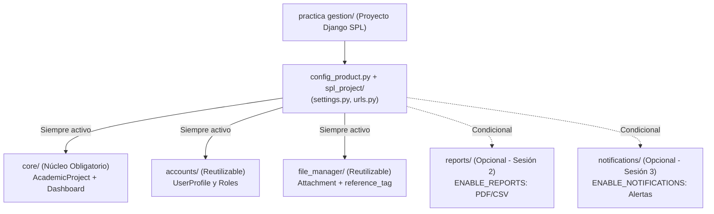
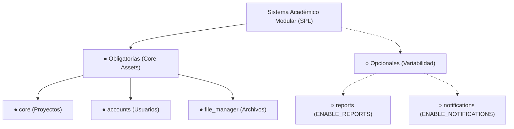

# INFORME DE PRÁCTICA N° 4 — GESTIÓN DE LA CONFIGURACIÓN DE SOFTWARE `[GESCONSOF]`

> **Documento maestro listo para copiar a Word / Google Docs / PDF.**  
> Todos los fragmentos de código, tablas, diagramas (`.png`, `.drawio` y Mermaid), capturas reales del sistema y anexos han sido verificados sobre el proyecto Django ubicado en `C:\Users\admin\Desktop\practica gestion`.

---

## DATOS GENERALES

| Campo | Detalle |
|---|---|
| **Institución** | Universidad Estatal de Milagro (UNEMI) |
| **Facultad** | Facultad Ciencias e Ingenierías |
| **Carrera** | Software en Modalidad Presencial |
| **Asignatura** | Gestión de la Configuración de Software `[GESCONSOF]` |
| **Guía de Práctica** | `G004-S13-SOFTWARE2019-PRESENCIAL-GESTIÓN DE LA CONFIGURACIÓN DE SOFTWARE-B1` — Práctica N° 4 |
| **Docente de la Asignatura** | Ing. Arévalo Gamboa Lissett Margarita |
| **Docente de la Práctica** | Ing. Oviedo Armijos Omar Andrés |
| **Integrantes del Grupo** | 1. Oswaldo Danilo Angulo Tamayo<br>2. Ezequiel Cristobal Jaramillo Yepez<br>3. Francisco Steven Arias Pérez<br>4. Darly Douglas Farías Mendoza |
| **Fecha** | Noviembre de 2026 |

---

## OBJETIVO DE LA PRÁCTICA

Analizar, modularizar y extender un sistema web en Django aplicando principios de reutilización, gestión de variantes y separación de funcionalidades, siguiendo el enfoque de **Línea de Productos de Software (SPL)**.

---

## SESIÓN 1 – Identificación de componentes reutilizables (`Oswaldo Danilo Angulo Tamayo`)

### 1.1 Selección del Proyecto Django
Se trabajó con el proyecto **Sistema Académico Modular de Proyectos (`spl_project`)** desarrollado en **Django 6.1.3** con Python 3.13 y base de datos SQLite, estructurado en aplicaciones independientes para facilitar el análisis de reutilización y variabilidad conforme al modelo de referencia **RiSE (Reuse in Software Engineering)**.

### 1.2 Hoja de Análisis de Funcionalidades

| ID | Módulo / Funcionalidad | Descripción Funcional | Clasificación SPL | Reutilizable en otros proyectos | Justificación Técnica |
|---|---|---|---|---|---|
| F-01 | Gestión de Usuarios y Roles (`accounts`) | Registro de perfiles institucionales (`UserProfile`), roles (`ADMIN`, `DOCENTE`, `ESTUDIANTE`) y directorio de integrantes. | **Core Asset Reutilizable (Obligatorio)** | **Sí (100%)** | Extiende `django.contrib.auth.models.User` vía `OneToOneField` sin dependencias a modelos propios del negocio académico. |
| F-02 | Carga y Gestión Documental (`file_manager`) | Subida, clasificación (`SPEC`, `DIAGRAM`, `REPORT`, `OTHER`) y listado de documentos técnicos (`Attachment`). | **Core Asset Reutilizable (Obligatorio)** | **Sí (100%)** | Desacoplado mediante etiqueta genérica `reference_tag` en lugar de llaves foráneas rígidas hacia `core`. |
| F-03 | Gestión de Proyectos Académicos (`core`) | CRUD/tablero de `AcademicProject`, filtros por estado, métricas de avance y context processor global de banderas SPL. | **Núcleo de Dominio (Obligatorio)** | Parcial (específico del dominio) | Representa la lógica central del negocio académico sobre la cual se acoplan los módulos transversales y opcionales. |
| F-04 | Panel de Reportes y Exportación PDF/CSV (`reports`) | Analítica resumida por categoría/estado y generación real de archivos PDF (`ReportLab`) y CSV con BOM UTF-8. | **Funcionalidad Opcional (Variante)** | **Sí (Plug-and-Play)** | Aislada como aplicación independiente controlada por `ENABLE_REPORTS` en `settings.py` y `urls.py`. |
| F-05 | Centro de Notificaciones y Alertas (`notifications`) | Gestión de alertas (`INFO`, `SUCCESS`, `WARNING`), emisión de avisos y marcado individual/masivo como leídas. | **Funcionalidad Opcional (Variante)** | **Sí (Plug-and-Play)** | Aislada como aplicación independiente activable únicamente en la variante completa mediante `ENABLE_NOTIFICATIONS`. |

### 1.3 Tabla Comparativa: Componentes Reutilizables vs. Específicos vs. Opcionales

| Dimensión de Análisis | Componentes Reutilizables (`accounts`, `file_manager`) | Componente Específico de Dominio (`core`) | Componentes Opcionales (`reports`, `notifications`) |
|---|---|---|---|
| **Rol en la SPL** | Activos base transversales (*Core Assets*) | Núcleo funcional propio del sistema académico | Puntos de variabilidad para derivar productos A y B |
| **Acoplamiento** | Bajo / nulo respecto al negocio | Medio (orquesta navegación y datos principales) | Desacoplado vía banderas y ruteo condicional |
| **Presencia en Variante A** | Activo (obligatorio) | Activo (obligatorio) | Desactivado (`False`, rutas retornan `404`) |
| **Presencia en Variante B** | Activo (obligatorio) | Activo (obligatorio) | Activo (`True`, rutas retornan `200`) |
| **Portabilidad** | Alta: copiable a cualquier proyecto Django | Baja: requiere adaptación al dominio destino | Alta: integrable mediante configuración de flags |

### 1.4 Diagrama de Arquitectura de Carpetas y Arquitectura Funcional
- **Diagrama 1 (Carpetas):** `diagramas/01_arquitectura_carpetas.png` *(editable en `diagramas/01_arquitectura_carpetas.drawio`)*
- **Diagrama 2 (Funcional):** `diagramas/02_arquitectura_funcional.png` *(editable en `diagramas/02_arquitectura_funcional.drawio`)*
- **Evidencia en vivo:** `capturas/07_sesion1_arquitectura_en_vivo.png`



---

## SESIÓN 2 – Modularización y separación de variantes (`Ezequiel Cristobal Jaramillo Yepez`)

### 2.1 Aislamiento de la Funcionalidad Opcional (`reports`)
Para evitar que la exportación de reportes quedara acoplada al núcleo `core`, se extrajo toda la lógica de resumen analítico y generación de PDF/CSV hacia la aplicación Django independiente `reports/`, conformada por:
- `reports/apps.py`: Registro formal de la aplicación (`ReportsConfig`).
- `reports/views.py`: Vistas `reports_dashboard`, `export_projects_pdf` (usando `reportlab`) y `export_projects_csv`, protegidas además por la verificación `_ensure_reports_enabled()`.
- `reports/urls.py`: Namespace `app_name = 'reports'` con las rutas `''`, `'export/pdf/'` y `'export/csv/'`.
- `reports/templates/reports/dashboard.html`: Plantilla encapsulada dentro de la propia app.

### 2.2 Implementación de la Bandera de Configuración (`ENABLE_REPORTS`)
En `spl_project/settings.py` se definió la bandera `ENABLE_REPORTS`, la cual controla la carga de la aplicación en `INSTALLED_APPS`:

```python
# spl_project/settings.py
ENABLE_REPORTS = _env_bool('SPL_ENABLE_REPORTS', ACTIVE_CONFIG['ENABLE_REPORTS'])

OPTIONAL_APPS = []
if ENABLE_REPORTS:
    OPTIONAL_APPS.append('reports')
```

En `core/views.py`, la vista principal evalúa la bandera antes de exponer opciones de exportación:

```python
# core/views.py
from django.conf import settings

if settings.ENABLE_REPORTS:
    # Mostrar opción de exportar reportes en PDF y CSV
    context['reports_panel_enabled'] = True
    context['export_formats'] = ['PDF (ReportLab)', 'CSV (Excel)']
```

Asimismo, en `templates/base.html` y `core/templates/core/dashboard.html`, el context processor `core.context_processors.spl_context` expone `ENABLE_REPORTS` para condicionar la interfaz de usuario:

```django

    <a href="" class="btn btn-emerald">Exportar Reporte PDF</a>
    <a href="" class="btn btn-outline">Exportar CSV</a>

```

### 2.3 Evidencia Visual (Con y Sin la Funcionalidad Activada)
- **Sin funcionalidad activada (`ENABLE_REPORTS = False`):** `capturas/01_sesion2_vista_sin_reportes.png`  
  Se observa el mensaje de modo básico y la ausencia de botones de descarga o pestaña de reportes en la barra superior.
- **Con funcionalidad activada (`ENABLE_REPORTS = True`):** `capturas/02_sesion2_vista_con_reportes.png`  
  Se habilita automáticamente el enlace superior `Reportes PDF/CSV ON`, el banner verde de módulo activo y los botones de exportación en PDF y CSV.

---

## SESIÓN 3 – Configuración de variabilidad (`Francisco Steven Arias Pérez`)

### 3.1 Archivo Central de Perfiles (`config_product.py`)
En la raíz del proyecto se implementó `config_product.py` definiendo las dos variantes solicitadas en la guía:

```python
# config_product.py
PRODUCT_A = {
    'NAME': 'Variante A — Sistema Básico',
    'CODE': 'PRODUCT_A',
    'DESCRIPTION': 'Núcleo académico y componentes reutilizables esenciales sin módulos extendidos.',
    'ENABLE_REPORTS': False,
    'ENABLE_NOTIFICATIONS': False,
}

PRODUCT_B = {
    'NAME': 'Variante B — Sistema Completo',
    'CODE': 'PRODUCT_B',
    'DESCRIPTION': 'Sistema completo con exportación de reportes PDF/CSV y centro de notificaciones.',
    'ENABLE_REPORTS': True,
    'ENABLE_NOTIFICATIONS': True,
}
```

La función `get_product_config()` lee la variable de entorno `SPL_VARIANT` (o usa `DEFAULT_VARIANT`), permitiendo desplegar cualquiera de las variantes sin modificar el código fuente de las vistas ni duplicar repositorios.

### 3.2 Enrutamiento Condicional con `include()` en `spl_project/urls.py`
Para garantizar que los endpoints opcionales no existan en la **Variante A** (retornando `404 Not Found`) y queden montados en la **Variante B** (`200 OK`), se implementó el enrutamiento dinámico:

```python
# spl_project/urls.py
urlpatterns = [
    path('admin/', admin.site.urls),
    path('', include('core.urls')),
    path('accounts/', include('accounts.urls')),
    path('files/', include('file_manager.urls')),
]

if settings.ENABLE_REPORTS:
    urlpatterns.append(path('reports/', include('reports.urls')))

if settings.ENABLE_NOTIFICATIONS:
    urlpatterns.append(path('notifications/', include('notifications.urls')))
```

### 3.3 Explicación Técnica de Gestión de Variantes
La gestión de variabilidad se resuelve en **tiempo de configuración/arranque** mediante tres capas sincronizadas:
1. **Capa de Selección (`config_product.py`):** Mapea un identificador de producto (`PRODUCT_A` o `PRODUCT_B`) a un diccionario booleano de características.
2. **Capa de Ensamblado (`settings.py` y `urls.py`):** Compone `INSTALLED_APPS` y `urlpatterns` dinámicamente. De este modo, en `PRODUCT_A` ni siquiera se cargan ni se enrutan las apps `reports` y `notifications`.
3. **Capa de Presentación (`context_processors.py` y plantillas):** Inyecta el estado de las banderas en el contexto HTML para adaptar menús, badges y tarjetas en tiempo real sin romper enlaces (`NoReverseMatch` evitado al proteger los `` dentro de `` y ``).

### 3.4 Capturas y Pruebas Automatizadas por Variante
- **Variante A (`PRODUCT_A`):** `capturas/03_sesion3_variante_A_sistema_basico.png` -> Dashboard `200 OK`, `/reports/` `404`, `/notifications/` `404`.
- **Variante B (`PRODUCT_B`):** `capturas/04_sesion3_variante_B_sistema_completo.png` -> Dashboard `200 OK`, `/reports/` `200 OK`, `/reports/export/pdf/` `200 OK (application/pdf)`, `/notifications/` `200 OK`.
- **Vistas de Módulos Extendidos en Variante B:** `capturas/05_sesion3_vista_reportes_y_pdf.png` y `capturas/06_sesion3_vista_notificaciones.png`.
- **Anexos reales generados:** `anexos/reporte_proyectos_spl_ejemplo.pdf` y `anexos/reporte_proyectos_spl_ejemplo.csv`.

---

## SESIÓN 4 – Documentación y línea de productos (`Darly Douglas Farías Mendoza`)

### 4.1 Análisis Guiado de la Línea de Productos

#### ¿Qué tienen en común todas las variantes?
Todas las variantes comparten la **infraestructura base del sistema** (*Core Assets*): el proyecto de configuración Django (`spl_project`), la base de datos y migraciones comunes, las plantillas maestras (`base.html` y hoja de estilos institucional `styles.css`), el núcleo de negocio (`core` con el modelo `AcademicProject` y tablero principal) y los dos módulos transversales reutilizables (`accounts` para gestión de usuarios/roles y `file_manager` para carga documental).

#### ¿Qué cambia entre ellas?
Cambia la **activación de funcionalidades opcionales orientadas al usuario avanzado y a la auditoría**:
- **Variante A (`PRODUCT_A`):** Desactiva `ENABLE_REPORTS` y `ENABLE_NOTIFICATIONS`. Entrega un sistema liviano enfocado únicamente en el registro y seguimiento básico de proyectos, usuarios y archivos.
- **Variante B (`PRODUCT_B`):** Activa `ENABLE_REPORTS = True` y `ENABLE_NOTIFICATIONS = True`, incorporando el módulo de analítica y exportación PDF/CSV (`reports/`) junto con el centro de alertas (`notifications/`), además de adaptar automáticamente la barra de navegación, los badges de estado y las rutas URL expuestas.

#### ¿Qué patrón de reutilización usaron?
Se combinó una arquitectura basada en **Componentes Modulares Desacoplados** (apps Django independientes siguiendo el enfoque del **Modelo RiSE**) con el patrón **Feature Toggles / Configuración de Variabilidad Centralizada** (`config_product.py` + inyección de contexto + `include()` condicional en `urls.py`). Esto permite reutilizar los activos comunes sin duplicar ramas de código (*branching* costoso) ni recurrir a *copy-paste* entre proyectos.

### 4.2 Manual Técnico Resumido (Entregable PDF Completo Adjunto)
El manual completo se encuentra generado en: **`entregables_documentacion/Manual_Linea_de_Productos_basada_en_Django.pdf`**.

#### A. Instrucciones para activar o desactivar características
1. Abrir `config_product.py` y editar las banderas booleanas del perfil deseado (`ENABLE_REPORTS` / `ENABLE_NOTIFICATIONS`), o definir la variable de entorno `SPL_VARIANT` (`PRODUCT_A` o `PRODUCT_B`).
2. Ejecutar el script correspondiente (`run_variante_a.bat` o `run_variante_b.bat`) o iniciar Django con:
   ```powershell
   $env:SPL_VARIANT="PRODUCT_B"
   .\venv\Scripts\python.exe manage.py runserver 8002
   ```
3. Verificar en la barra superior del sistema el estado activo de cada bandera y validar con `python scripts/verify_spl.py`.

#### B. Recomendaciones para reutilizar apps entre proyectos Django
1. **Evitar dependencias circulares o llaves foráneas rígidas hacia el núcleo:** Usar etiquetas genéricas (como `reference_tag` en `file_manager`) o referencias configurables (`settings.AUTH_USER_MODEL`).
2. **Declarar siempre `app_name` en `urls.py`:** Permite montar la app bajo cualquier prefijo URL sin colisión de nombres.
3. **Encapsular plantillas y estáticos por app:** Ubicar HTML en `<app>/templates/<app>/` para mantener la portabilidad al copiar la carpeta.
4. **Proveer valores por defecto seguros en `settings`:** Utilizar `getattr(settings, 'FLAG', False)` para evitar errores en proyectos que no declaren la bandera.
5. **Empaquetar módulos maduros:** Convertir apps transversales como `accounts` o `file_manager` en paquetes instalables (`pyproject.toml`) para compartirlos en múltiples repositorios de la organización.

### 4.3 Presentación de la Línea de Productos (Diagrama SPL y Tabla de Variantes)
- **Modelo de Características (FODA):** `diagramas/03_modelo_caracteristicas_spl.png` *(editable en `diagramas/03_modelo_caracteristicas_spl.drawio`)*
- **Árbol de Decisiones de Variantes:** `diagramas/04_arbol_decisiones_variantes.png` *(editable en `diagramas/04_arbol_decisiones_variantes.drawio`)*



#### Tabla de Variantes y Configuración

| Característica / App | Tipo en Modelo SPL | Bandera de Control | Variante A (`PRODUCT_A`) | Variante B (`PRODUCT_B`) | Variante Intermedia (Sesión 2) |
|---|---|---|---|---|---|
| `core` (Tablero y Proyectos) | Obligatoria (Núcleo) | Siempre activa | Incluida (`200 OK`) | Incluida (`200 OK`) | Incluida (`200 OK`) |
| `accounts` (Usuarios/Roles) | Obligatoria (Reutilizable) | Siempre activa | Incluida (`200 OK`) | Incluida (`200 OK`) | Incluida (`200 OK`) |
| `file_manager` (Archivos) | Obligatoria (Reutilizable) | Siempre activa | Incluida (`200 OK`) | Incluida (`200 OK`) | Incluida (`200 OK`) |
| `reports` (Exportar PDF/CSV) | Opcional | `ENABLE_REPORTS` | `False` (`404 Not Found`) | `True` (`200 OK`) | `True` (`200 OK`) |
| `notifications` (Alertas) | Opcional | `ENABLE_NOTIFICATIONS` | `False` (`404 Not Found`) | `True` (`200 OK`) | `False` (`404 Not Found`) |

---

## RESULTADOS OBTENIDOS DE VERIFICACIÓN AUTOMATIZADA

Las pruebas unitarias (`manage.py test`) y la suite de verificación por procesos independientes (`scripts/verify_spl.py`) confirmaron:

| Escenario Evaluado | Variables de Entorno | `/` (Dashboard) | `/accounts/` & `/files/` | `/reports/` & `/reports/export/pdf/` | `/notifications/` | Estado |
|---|---|---|---|---|---|---|
| **Variante A (Básica)** | `SPL_VARIANT=PRODUCT_A` | `200 OK` (sin botones opcionales) | `200 OK` | `404 Not Found` | `404 Not Found` | **APROBADO** |
| **Sesión 2 (Aislamiento)** | `SPL_VARIANT=PRODUCT_A`, `SPL_ENABLE_REPORTS=True` | `200 OK` (solo reportes activos) | `200 OK` | `200 OK` (`%PDF` válido) | `404 Not Found` | **APROBADO** |
| **Variante B (Completa)** | `SPL_VARIANT=PRODUCT_B` | `200 OK` (reportes + alertas) | `200 OK` | `200 OK` (`%PDF` + CSV) | `200 OK` | **APROBADO** |

---

## CONCLUSIONES Y RECOMENDACIONES POR CADA ESTUDIANTE

### 1. Oswaldo Danilo Angulo Tamayo
- **Conclusión:** El análisis inicial de funcionalidades y la clasificación temprana entre componentes reutilizables (`accounts`, `file_manager`), núcleo específico (`core`) y módulos opcionales permitió estructurar el proyecto Django bajo los principios del modelo RiSE, reduciendo el acoplamiento y garantizando que los activos comunes puedan aprovecharse en futuros sistemas web académicos.
- **Recomendación:** Realizar siempre una matriz de trazabilidad y análisis de dependencias antes de escribir código, evitando referencias directas entre apps reutilizables y modelos específicos del dominio para preservar la portabilidad entre proyectos.

### 2. Ezequiel Cristobal Jaramillo Yepez
- **Conclusión:** El aislamiento de la generación de reportes PDF/CSV en la aplicación independiente `reports/` demostró que es posible modularizar características opcionales sin alterar la estabilidad del sistema base; el uso de la bandera `ENABLE_REPORTS` en `settings.py`, vistas y plantillas permite habilitar o retirar la funcionalidad de forma limpia y reversible.
- **Recomendación:** Mantener cada característica opcional encapsulada con sus propias vistas, plantillas y rutas con espacio de nombres (`app_name`), validando además en el controlador que la bandera esté activa para evitar accesos no previstos si alguien intenta invocar la ruta directamente.

### 3. Francisco Steven Arias Pérez
- **Conclusión:** La centralización de perfiles en `config_product.py` (`PRODUCT_A` y `PRODUCT_B`) combinada con el uso de `include()` condicional en `spl_project/urls.py` permitió derivar dos productos funcionalmente distintos a partir de una única base de código fuente, eliminando la necesidad de mantener copias o ramas separadas por cliente.
- **Recomendación:** Automatizar la verificación de cada variante en el flujo de integración continua (como en `scripts/verify_spl.py`) para comprobar que la desactivación de una característica en `PRODUCT_A` no genere errores `NoReverseMatch` en plantillas ni deje endpoints expuestos.

### 4. Darly Douglas Farías Mendoza
- **Conclusión:** La documentación integral de la línea de productos —incluyendo el modelo de características FODA, el árbol de decisiones, la tabla de variantes y el manual técnico en PDF— resulta indispensable en la Gestión de la Configuración de Software, pues convierte un conjunto de banderas técnicas en un catálogo comprensible y replicable para todo el equipo de desarrollo.
- **Recomendación:** Mantener sincronizados el archivo `config_product.py`, el diagrama de características SPL y el manual de configuración cada vez que se agregue una nueva variante o módulo opcional, y considerar el empaquetado de las apps transversales (`accounts` y `file_manager`) como librerías instalables vía `pip`.

---

## REFERENCIAS BIBLIOGRÁFICAS

- Pressman, R. S. (2005). *Ingeniería del software: Un enfoque práctico*. México: McGraw-Hill.
- Sommerville, I. (2011). *Ingeniería de software*. Madrid: Pearson Educación de México.
- Django Software Foundation. (2026). *Django Documentation: Reusable Apps & URL Dispatcher*.

---

## ANEXO EXTRA — BANCO DE PREGUNTAS Y RESPUESTAS PARA DEFENSA ORAL ANTE EL DOCENTE

1. **¿Qué diferencia hay entre una aplicación Django tradicional y una pensada para Línea de Productos de Software (SPL)?**  
   *Respuesta:* En una app tradicional toda la lógica y rutas suelen quedar acopladas y activas para un único producto. En una SPL se distinguen activos comunes obligatorios (*Core Assets*, aquí `core`, `accounts` y `file_manager`) y puntos de variación controlados (`reports`, `notifications`) mediante configuración centralizada (`config_product.py`), permitiendo derivar múltiples variantes desde un mismo repositorio sin duplicar código.

2. **¿Por qué `accounts` y `file_manager` son reutilizables y `core` es específico?**  
   *Respuesta:* `accounts` gestiona usuarios y roles sobre el modelo estándar `User` de Django, y `file_manager` usa una etiqueta genérica (`reference_tag`) sin llaves foráneas rígidas hacia `AcademicProject`. Por eso pueden copiarse a otro sistema (por ejemplo, una clínica o biblioteca) sin reescribir modelos, mientras que `core` modela entidades propias de proyectos académicos.

3. **¿Qué ocurre técnicamente cuando cambiamos de `PRODUCT_B` a `PRODUCT_A`?**  
   *Respuesta:* `config_product.py` cambia `ENABLE_REPORTS` y `ENABLE_NOTIFICATIONS` a `False`. Al iniciar Django, `settings.py` excluye `reports` y `notifications` de `INSTALLED_APPS`, `urls.py` omite sus `include()` condicionales (haciendo que `/reports/` y `/notifications/` respondan `404`), y el context processor oculta los enlaces y botones en `base.html` y `dashboard.html`.

4. **¿Qué evita errores en las plantillas cuando una URL opcional no está incluida en `urls.py`?**  
   *Respuesta:* Todas las etiquetas `` y `` están envueltas en bloques `` y ``. Así Django nunca intenta resolver un nombre de ruta inexistente en `PRODUCT_A` y no se produce `NoReverseMatch`.

5. **¿Cómo se relaciona esta práctica con el Modelo RiSE mencionado en el sílabo?**  
   *Respuesta:* El modelo **RiSE** promueve la adopción sistemática de la reutilización mediante identificación de activos reutilizables (Sesión 1), modularización/empaquetado independiente (Sesión 2), gestión de variabilidad/configuración (Sesión 3) y documentación/gobierno de la línea de productos (Sesión 4).

